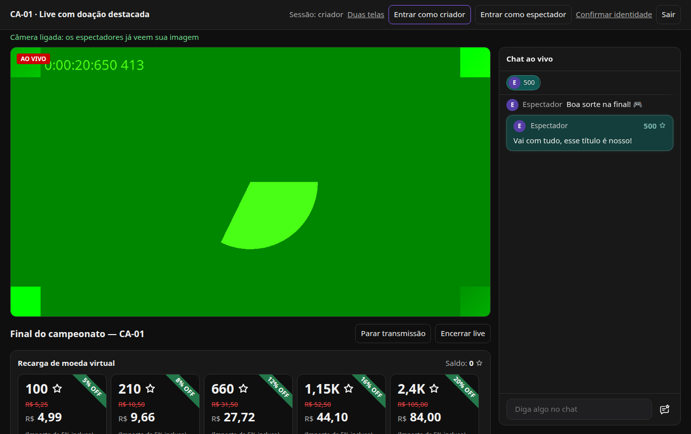
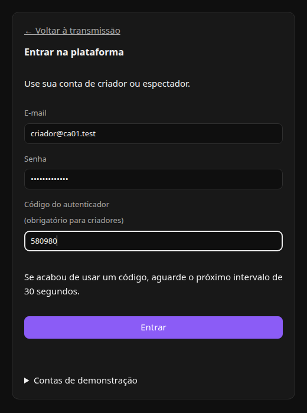
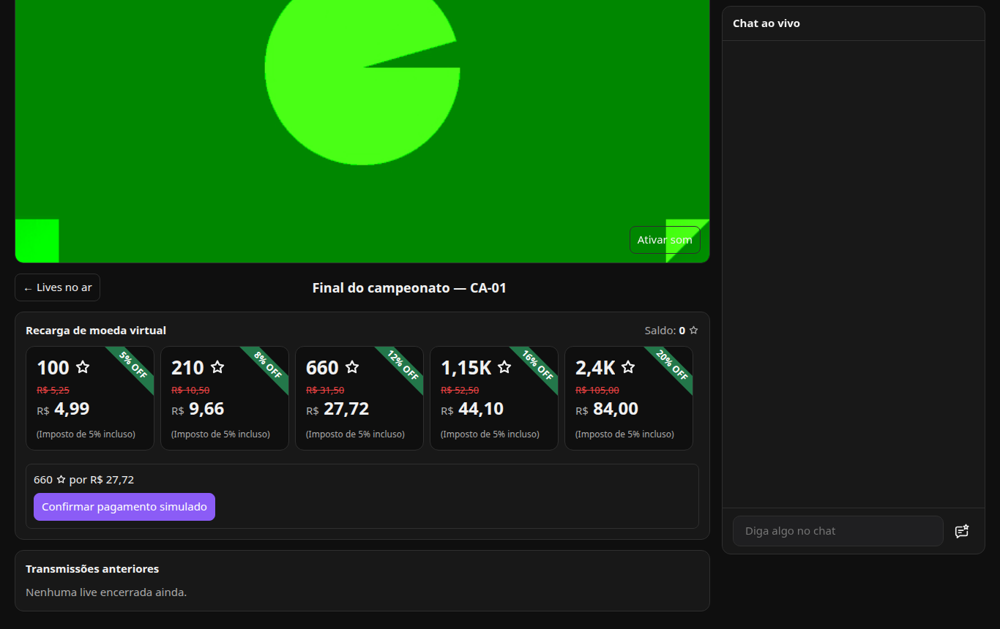
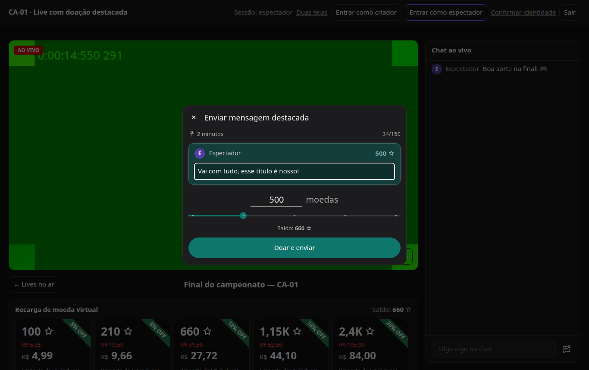
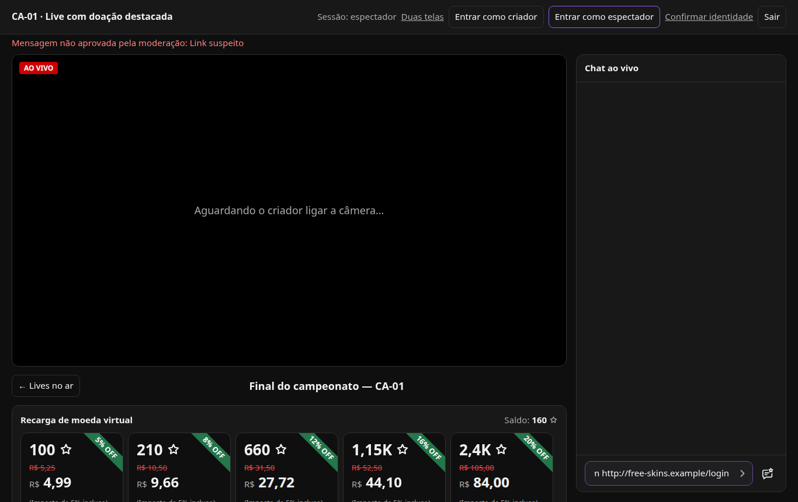

# Plataforma de Streaming de Vídeo — Entrega 04

**Código da Disciplina**: FGA0208<br>
**Número do Grupo**: 06<br>
**Entrega**: 04<br>

- **Documentação:** [GitHub Pages da Entrega 04](https://unbarqdsw2026-2-turma01.github.io/2026.2-T01-_G6_ProjetoStreamingVideo_Entrega_04/)
- **Código:** [2026.2-T01-_G6_ProjetoStreamingVideo_Entrega_04_Codigo](https://github.com/UnBArqDsw2026-2-Turma01/2026.2-T01-_G6_ProjetoStreamingVideo_Entrega_04_Codigo)
- **Etapa anterior:** [Entrega 03](https://unbarqdsw2026-2-turma01.github.io/2026.2-T01-_G6_ProjetoStreamingVideo_Entrega_03/)

## Alunos

| Matrícula | Integrante | Subequipe | GitHub |
| --- | --- | --- | --- |
| 24/1039645 | Lucas Andrade Zanetti | SubEquipe_01 | [@Bappoz](https://github.com/Bappoz) |
| 24/1031852 | Matheus Lemes Amaral | SubEquipe_01 | [@1emes](https://github.com/1emes) |
| 24/1040332 | Pedro Druck Montalvão Reis | SubEquipe_01 | [@pedruck](https://github.com/pedruck) |
| 24/1039073 | Heitor Macedo Ricardo | SubEquipe_01 | [@HeitorM50](https://github.com/HeitorM50) |
| 24/1011018 | Davi Severiano Freitas | SubEquipe_02 | [@Davi-UnB](https://github.com/Davi-UnB) |
| 24/1025505 | Daniel de Oliveira Lira | SubEquipe_02 | [@Daniellira540](https://github.com/Daniellira540) |
| 24/1011466 | Mateus Rodrigues Barreto | SubEquipe_02 | [@Mateus0xC](https://github.com/Mateus0xC) |
| 23/1026545 | Pedro Henrique Freire Rodrigues | SubEquipe_02 | [@Pedro-Henrique3](https://github.com/Pedro-Henrique3) |
| 24/1041302 | Hugo Freitas Silva | SubEquipe_03 | [@HugoFreitass](https://github.com/HugoFreitass) |
| 24/1040350 | Philipe Amâncio Reis Caetano | SubEquipe_03 | [@Phill-Chill](https://github.com/Phill-Chill) |
| 24/1011027 | Eduardo Lôbo Moreira | SubEquipe_03 | [@EduLoboM](https://github.com/EduLoboM) |

## Sobre

Plataforma de streaming de vídeo com ênfase em transmissões ao vivo e conteúdo gerado pelos usuários (UGC). Esta entrega descreve a arquitetura do sistema em um **Documento de Arquitetura (DAS)**, organizado no modelo 4+1, e registra o ponto de vista de cada integrante sobre o uso de **IA Generativa**. O DAS parte dos modelos da [Entrega 02](https://unbarqdsw2026-2-turma01.github.io/2026.2-T01-_G6_ProjetoStreamingVideo_Entrega_02/) e dos padrões GoF implementados na [Entrega 03](https://unbarqdsw2026-2-turma01.github.io/2026.2-T01-_G6_ProjetoStreamingVideo_Entrega_03/).

## Screenshots da Quarta Entrega

Capturas da página integrada do CA-01 (`apps/web` do [repositório de código](https://github.com/UnBArqDsw2026-2-Turma01/2026.2-T01-_G6_ProjetoStreamingVideo_Entrega_04_Codigo), commit `c020c93`), executada localmente com `npm run web` e as contas de demonstração. O vídeo é a câmera simulada do navegador; o pagamento usa o gateway simulado.

<p align="center"></p>
<p align="center"><sub><b>Figura 1</b> — Criador ao vivo: o chat recebe a mensagem comum e a mensagem destacada de 500 moedas, fixada no topo. Fluxo doação → chat da <a href="https://unbarqdsw2026-2-turma01.github.io/2026.2-T01-_G6_ProjetoStreamingVideo_Entrega_04/#/Base/Relatórios/1.1.1.DAS/1.1.1.6.VisaoProcessos.md">Visão de Processos</a>, com <a href="https://github.com/UnBArqDsw2026-2-Turma01/2026.2-T01-_G6_ProjetoStreamingVideo_Entrega_04_Codigo/tree/c020c9302dd4110dc0c69d0a032a623962bdd7c9/packages/monetizacao/src/destaque"><code>@g6/monetizacao</code></a> e <a href="https://github.com/UnBArqDsw2026-2-Turma01/2026.2-T01-_G6_ProjetoStreamingVideo_Entrega_04_Codigo/tree/c020c9302dd4110dc0c69d0a032a623962bdd7c9/packages/chat"><code>@g6/chat</code></a>.</sub></p>

<p align="center"></p>
<p align="center"><sub><b>Figura 2</b> — Login do criador com senha e código TOTP obrigatório, pela <code>AutenticacaoPort</code> real (<a href="https://github.com/UnBArqDsw2026-2-Turma01/2026.2-T01-_G6_ProjetoStreamingVideo_Entrega_04_Codigo/tree/c020c9302dd4110dc0c69d0a032a623962bdd7c9/packages/identidade"><code>@g6/identidade</code></a> e <a href="https://github.com/UnBArqDsw2026-2-Turma01/2026.2-T01-_G6_ProjetoStreamingVideo_Entrega_04_Codigo/tree/c020c9302dd4110dc0c69d0a032a623962bdd7c9/apps/web/src/auth"><code>apps/web/src/auth</code></a>). Cenário QA-02 da seção <a href="https://unbarqdsw2026-2-turma01.github.io/2026.2-T01-_G6_ProjetoStreamingVideo_Entrega_04/#/Base/Relatórios/1.1.1.DAS/1.1.1.11.Qualidade.md">Qualidade</a>.</sub></p>

<p align="center"></p>
<p align="center"><sub><b>Figura 3</b> — Recarga de moeda virtual: preços montados pelo Decorator (desconto e imposto) e checkout pendente até a confirmação do pagamento simulado (<a href="https://github.com/UnBArqDsw2026-2-Turma01/2026.2-T01-_G6_ProjetoStreamingVideo_Entrega_04_Codigo/tree/c020c9302dd4110dc0c69d0a032a623962bdd7c9/packages/monetizacao/src/recarga"><code>@g6/monetizacao/recarga</code></a>; elos na <a href="https://unbarqdsw2026-2-turma01.github.io/2026.2-T01-_G6_ProjetoStreamingVideo_Entrega_04/#/Base/Relatórios/1.1.1.DAS/1.1.1.12.Rastreabilidade.md">Matriz de Rastreabilidade</a>).</sub></p>

<p align="center"></p>
<p align="center"><sub><b>Figura 4</b> — Doação com mensagem destacada: a faixa (cor, tempo de fixação e limite de caracteres) acompanha o valor, conforme o Decorator da mensagem destacada (<a href="https://github.com/UnBArqDsw2026-2-Turma01/2026.2-T01-_G6_ProjetoStreamingVideo_Entrega_04_Codigo/tree/c020c9302dd4110dc0c69d0a032a623962bdd7c9/packages/monetizacao/src/destaque"><code>src/destaque</code></a>).</sub></p>

<p align="center"></p>
<p align="center"><sub><b>Figura 5</b> — Moderação antes da entrega: a mensagem com link suspeito é recusada e não chega ao chat (<a href="https://github.com/UnBArqDsw2026-2-Turma01/2026.2-T01-_G6_ProjetoStreamingVideo_Entrega_04_Codigo/tree/c020c9302dd4110dc0c69d0a032a623962bdd7c9/packages/moderacao"><code>@g6/moderacao</code></a> pela <code>ModeracaoPort</code>; cenário QA-04 da seção <a href="https://unbarqdsw2026-2-turma01.github.io/2026.2-T01-_G6_ProjetoStreamingVideo_Entrega_04/#/Base/Relatórios/1.1.1.DAS/1.1.1.11.Qualidade.md">Qualidade</a>).</sub></p>

## Há algo a ser executado?

( X ) SIM

( ) NÃO

O cenário arquitetural CA-01 é executado no [repositório de código](https://github.com/UnBArqDsw2026-2-Turma01/2026.2-T01-_G6_ProjetoStreamingVideo_Entrega_04_Codigo); o manual de execução fica no README de lá.

Para visualizar esta documentação localmente:

```bash
python3 -m http.server 8000 --directory docs
```

Acesse `http://localhost:8000`. O Docsify é carregado por CDN e precisa de internet.

## Informações Complementares

- Planejamento: [`docs/Projeto/Planejamento.md`](docs/Projeto/Planejamento.md) (PDF em `docs/Projeto/assets/`).
- Issues e milestones: [documentação](https://github.com/UnBArqDsw2026-2-Turma01/2026.2-T01-_G6_ProjetoStreamingVideo_Entrega_04/issues) · [código](https://github.com/UnBArqDsw2026-2-Turma01/2026.2-T01-_G6_ProjetoStreamingVideo_Entrega_04_Codigo/issues).
- Como contribuir: [CONTRIBUTING.md](CONTRIBUTING.md).
