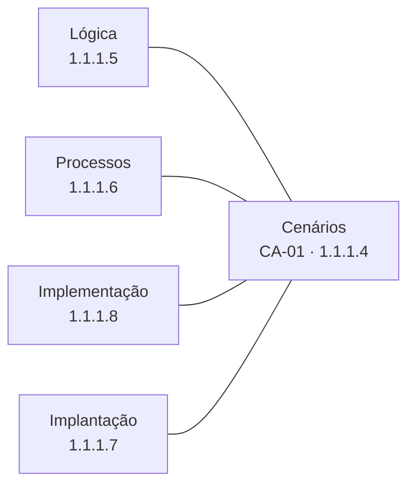
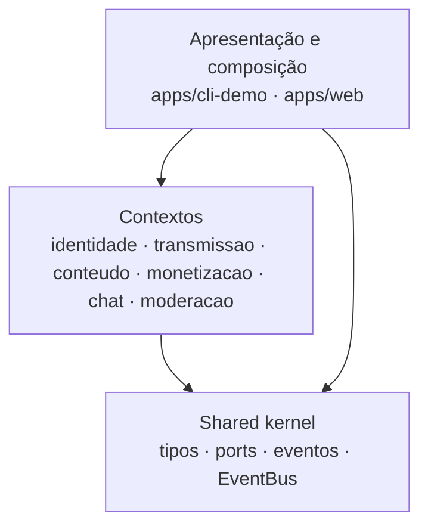

# 1.1.1.2. Representação Arquitetural

> **Responsável:** Lucas Andrade Zanetti · **Revisão cruzada:** SubEquipe_03 · **Issue:** [#3](https://github.com/UnBArqDsw2026-2-Turma01/2026.2-T01-_G6_ProjetoStreamingVideo_Entrega_04/issues/3) · **Status:** 🟡 rascunho completo, aguardando revisão cruzada

## Conteúdo

### Modelo de visões adotado

O DAS usa o **modelo 4+1** (KRUCHTEN, 1995), que é o modelo do documento de arquitetura indicado na diretriz: quatro visões do sistema, amarradas por **cenários**. Cada visão responde a uma pergunta diferente, e nenhuma delas sozinha descreve a arquitetura.

| Visão | Pergunta que responde | Interessados | Notação principal prevista | Seção | Autoria | Situação na entrega |
| --- | --- | --- | --- | --- | --- | --- |
| **Cenários** (o “+1”) | Quais fluxos importam para a arquitetura e guiam as demais visões? | todos | casos de uso e sequência | [1.1.1.4](/Base/Relatórios/1.1.1.DAS/1.1.1.4.VisaoCasosDeUso.md) | SG1 | planejada |
| **Lógica** | Como o sistema se divide em partes e quais dependências são permitidas? | quem desenvolve; avaliação | diagrama de pacotes (e de classes por contexto) | [1.1.1.5](/Base/Relatórios/1.1.1.DAS/1.1.1.5.VisaoLogica.md) | SG1 | **obrigatória** |
| **Processos** | Como se comporta em execução: concorrência, comunicação e falhas? | quem desenvolve e testa | sequência e atividades | [1.1.1.6](/Base/Relatórios/1.1.1.DAS/1.1.1.6.VisaoProcessos.md) | SG3 | planejada |
| **Implementação** | Como o código está organizado e que interfaces cada pacote provê e requer? | quem desenvolve | diagrama de componentes | [1.1.1.8](/Base/Relatórios/1.1.1.DAS/1.1.1.8.VisaoImplementacao.md) | SG2 | planejada |
| **Implantação** | Em que nós o sistema roda? | quem opera; avaliação | diagrama de implantação | [1.1.1.7](/Base/Relatórios/1.1.1.DAS/1.1.1.7.VisaoImplantacao.md) | SG2 | reforço |
| **Dados** | Como se persiste a informação? | — | — | [1.1.1.9](/Base/Relatórios/1.1.1.DAS/1.1.1.9.VisaoDados.md) | SG2 | **fora do escopo** (dados em memória) |

A diretriz exige a Visão Lógica e mais uma visão, com algo rodando. O plano cobre **duas** além da Lógica (Implementação e Processos), com a Implantação como reforço, para manter margem caso uma delas atrase. A notação de cada visão é a **prevista**; a subequipe autora confirma ou ajusta na própria seção.

### Estilo arquitetural

**Camadas + contextos delimitados, integrados por um shared kernel**, executados em um único processo (monólito modular).

- **Camadas.** A apresentação compõe os contextos reais; os contextos dependem apenas do kernel; o kernel não depende de nada do monorepo. A dependência só desce.
- **Contextos delimitados.** Cada contexto é um pacote com o modelo próprio, e vem do código de uma subequipe na Entrega 03.
- **Comunicação entre contextos** por dois mecanismos, ambos definidos no kernel: chamada a um **port** (interface síncrona, ex.: a doação pede ao chat que publique a mensagem) e **eventos de domínio** em um *event bus* em memória (ex.: o fim da live avisa quem quiser reagir).
- **Composição só nas bordas.** Apenas `apps/*` conhecem as implementações concretas de cada port.

Regras de dependência que decorrem do estilo (a verificação automática delas é a [extra E2, issue #18 do código](https://github.com/UnBArqDsw2026-2-Turma01/2026.2-T01-_G6_ProjetoStreamingVideo_Entrega_04_Codigo/issues/18)):

| Origem → destino | Situação |
| --- | --- |
| `apps/*` → contexto ou kernel | permitido |
| contexto → `shared-kernel` | permitido |
| contexto → **outro contexto** | **proibido** |
| `shared-kernel` → qualquer pacote do monorepo | **proibido** |

**Por que esse estilo.** Duas razões, uma de projeto e uma de qualidade:

- *Restrição do trabalho:* onze pessoas em três subequipes, cada uma com código próprio da Entrega 03. Contextos independentes e um contrato comum permitem desenvolver e testar em paralelo (ver o [guia do repositório de código](https://github.com/UnBArqDsw2026-2-Turma01/2026.2-T01-_G6_ProjetoStreamingVideo_Entrega_04_Codigo/blob/main/CONTRIBUTING.md)).
- *Qualidade:* o isolamento entre contextos sustenta regras de confiabilidade já levantadas nas entregas anteriores, como a de que **uma falha no chat não desfaz a doação**, e mantém a autenticação e a moderação em fronteiras que se podem revisar separadamente. O SIG de cada subequipe na Entrega 01 (desempenho/latência, confiabilidade/disponibilidade, segurança) é o ponto de partida da seção [Metas e Restrições](/Base/Relatórios/1.1.1.DAS/1.1.1.3.MetasRestricoes.md).

### Notações e ferramentas

| Item | Convenção |
| --- | --- |
| Notação | UML 2.5.1 (pacotes, classes, componentes, implantação, sequência, atividades, casos de uso) |
| Fonte dos diagramas | arquivo `.puml` (PlantUML) **versionado** junto da imagem exportada, como na Entrega 03 |
| Esboços nas páginas | Mermaid, renderizado pelo Docsify (como nesta página) |
| Legenda | número da figura, descrição, autoria e versão, como na Entrega 02; a versão também vai no nome do arquivo (`-v1`), como na Entrega 03 |
| Nomes de contexto | o mesmo em todas as visões e igual ao pacote do repositório: `identidade`, `transmissao`, `conteudo`, `monetizacao`, `chat`, `moderacao` |
| Nomes de port e evento | port `NomePort` (ex.: `ChatPort`); evento em português, no passado (ex.: `LiveEncerrada`). Os nomes finais saem do contrato (issue #3 do repositório de código). |

### Mapa das visões

Para que a Visão Lógica não fique só no papel, cada visão aponta o que a sustenta no repositório de código. **Hoje** o repositório tem o esqueleto do monorepo ([PR #24](https://github.com/UnBArqDsw2026-2-Turma01/2026.2-T01-_G6_ProjetoStreamingVideo_Entrega_04_Codigo/pull/24)); as implementações correspondem às issues citadas.

| Visão | Evidência no código | Issue do código | Situação hoje |
| --- | --- | --- | --- |
| Cenários | roteiro CA-01 no terminal, `apps/cli-demo` | [#15](https://github.com/UnBArqDsw2026-2-Turma01/2026.2-T01-_G6_ProjetoStreamingVideo_Entrega_04_Codigo/issues/15) | esqueleto |
| Lógica | pacotes `packages/*`, `@g6/shared-kernel` e a verificação das regras de dependência | [#3](https://github.com/UnBArqDsw2026-2-Turma01/2026.2-T01-_G6_ProjetoStreamingVideo_Entrega_04_Codigo/issues/3) · [#18](https://github.com/UnBArqDsw2026-2-Turma01/2026.2-T01-_G6_ProjetoStreamingVideo_Entrega_04_Codigo/issues/18) | pacotes vazios; regra por convenção |
| Processos | EventBus, `transmissao/src/canal` (Observer), `chat` | [#4](https://github.com/UnBArqDsw2026-2-Turma01/2026.2-T01-_G6_ProjetoStreamingVideo_Entrega_04_Codigo/issues/4) · [#7](https://github.com/UnBArqDsw2026-2-Turma01/2026.2-T01-_G6_ProjetoStreamingVideo_Entrega_04_Codigo/issues/7) · [#13](https://github.com/UnBArqDsw2026-2-Turma01/2026.2-T01-_G6_ProjetoStreamingVideo_Entrega_04_Codigo/issues/13) | não implementado |
| Implementação | npm workspaces, `CODEOWNERS`, ports do kernel | [#2](https://github.com/UnBArqDsw2026-2-Turma01/2026.2-T01-_G6_ProjetoStreamingVideo_Entrega_04_Codigo/issues/2) (concluída) | monorepo criado |
| Implantação | servidor Node de `apps/web`; Docker Compose (extra) | [#16](https://github.com/UnBArqDsw2026-2-Turma01/2026.2-T01-_G6_ProjetoStreamingVideo_Entrega_04_Codigo/issues/16) · [#20](https://github.com/UnBArqDsw2026-2-Turma01/2026.2-T01-_G6_ProjetoStreamingVideo_Entrega_04_Codigo/issues/20) | não implementado |

Cada seção, ao ser escrita, deve atualizar a coluna “situação hoje” com o que foi de fato verificado no código.

## O que mudou desde a E02/E03 e por quê

| Antes | Agora | Por quê |
| --- | --- | --- |
| E02: diagrama de componentes cobrindo só o escopo da SG1, com interfaces de prefixo `I…` (ex.: `IClip`) | descrição do sistema inteiro em visões; portas nomeadas `…Port` na proposta de contrato | o DAS precisa do todo. **Divergência de convenção a resolver** na issue #3 do repositório de código: manter o prefixo `I` da E02 ou adotar `Port` com mapeamento entre os dois. |
| E02: `EventBus` no subsistema de transmissão, com eventos como `StreamOnline`/`StreamOffline` e `RecordingAvailable` | proposta de eventos `LiveIniciada`/`LiveEncerrada` no kernel | provável equivalência entre os eventos de ciclo da live; **a confirmar** na issue #3, para não haver dois vocabulários para o mesmo fato. |
| E03: cada padrão GoF implementado de forma isolada por subequipe | cada padrão dentro de um contexto, atrás de um port | o CA-01 liga os padrões; por exemplo, o Mediator da doação passa a falar com o `ChatPort`, e não com o chat diretamente. |
| E02 e E03: artefatos organizados por subequipe e foco | DAS organizado por **visão**, com a matriz de rastreabilidade ligando os dois eixos | o DAS responde a preocupações, não a divisão de trabalho. A matriz ([1.1.1.12](/Base/Relatórios/1.1.1.DAS/1.1.1.12.Rastreabilidade.md)) preserva o caminho de volta. |

## Decisões e senso crítico

- **4+1 em vez de só C4.** A diretriz pede o modelo de documento de arquitetura (derivado do SAD do RUP), que se organiza em visões. O C4 fica como extra opcional, com correspondência às visões (extra E7). Limite do 4+1: ele diz *quais* visões, mas não *quanto detalhe* cada uma deve ter; esse nível é decidido seção a seção e é o ponto mais sujeito a inconsistência.
- **Monólito modular em um processo.** Simplifica a integração e a demonstração (um comando roda o CA-01) e é coerente com o código das Entregas 03. O custo é que **não demonstra distribuição**: os contextos poderiam virar serviços, mas este documento não afirma isso nem o prova. A decisão e a alternativa serão registradas em ADR (issue [#19](https://github.com/UnBArqDsw2026-2-Turma01/2026.2-T01-_G6_ProjetoStreamingVideo_Entrega_04/issues/19) desta documentação).
- **Shared kernel em vez de camada anticorrupção.** O kernel dá integração simples, mas **acopla as subequipes**: mudar um port afeta quem o provê e quem o consome. A alternativa, uma camada de tradução entre contextos, isola mais e custa mais código; o ADR-008 (a escrever) registra o trade-off.
- **Visões escritas por subequipes diferentes.** Cada autor conhece melhor parte do sistema (ressalva registrada na [ata](/Projeto/Atas/ata-G01-entrega-04.md), D02). Mitigações: revisão cruzada de toda seção, vocabulário comum (tabela *Notações e ferramentas*), matriz de rastreabilidade e checagem das visões contra o código. O risco de uma visão descrever algo que o código não faz permanece e é tratado em cada seção.
- **Regras de dependência valem hoje por convenção e revisão.** A verificação automática depende da issue #18 do repositório de código; até lá, esta seção descreve uma regra que ainda não é imposta por ferramenta.

## Rastreabilidade

| Elemento desta seção | Origem (E01/E02/E03) | Link |
| --- | --- | --- |
| Estilo e regras de isolamento entre contextos (ex.: falha no chat não desfaz a doação) | E03, organização da SubEquipe_02, regra de independência entre doação e chat | [Organização da Entrega 3](https://unbarqdsw2026-2-turma01.github.io/2026.2-T01-_G6_ProjetoStreamingVideo_Entrega_03/#/Projeto/Atas/Atas_Sg2/organizacao-entrega-03.md) |
| Atributos de qualidade que justificam o isolamento | E01, SIG de cada subequipe | [SG1](https://unbarqdsw2026-2-turma01.github.io/2026.2-T01-_G6_ProjetoStreamingVideo_Entrega_01/#/Base/Relatorios/1.1.1.SubEquipe_01/2.NFRFramework.md) · [SG2](https://unbarqdsw2026-2-turma01.github.io/2026.2-T01-_G6_ProjetoStreamingVideo_Entrega_01/#/Base/Relatorios/1.1.2.SubEquipe_02/2.NFRFramework.md) · [SG3](https://unbarqdsw2026-2-turma01.github.io/2026.2-T01-_G6_ProjetoStreamingVideo_Entrega_01/#/Base/Relatorios/1.1.3.SubEquipe_03/2.NFRFramework.md) |
| Convenção de interfaces `I…` e `EventBus` na transmissão | E02, diagrama de componentes da SubEquipe_01 | [Diagrama de componentes](https://unbarqdsw2026-2-turma01.github.io/2026.2-T01-_G6_ProjetoStreamingVideo_Entrega_02/#/Base/Relatórios/1.1.1.SubEquipe_01/1.1.1.9.Extra.DiagramaComponentes.md) |
| Padrões que cada contexto reúne | E03, visão geral e ADR-001 a ADR-004 | [Padrões de Projeto](https://unbarqdsw2026-2-turma01.github.io/2026.2-T01-_G6_ProjetoStreamingVideo_Entrega_03/#/Base/1.PadroesDeProjeto.md) |
| Integração por shared kernel e divisão das visões entre subequipes | E04, ata de abertura (D02 e D08) | [Ata](/Projeto/Atas/ata-G01-entrega-04.md) |

## Referências

- BASS, Len; CLEMENTS, Paul; KAZMAN, Rick. *Software Architecture in Practice*. 4. ed. Addison-Wesley, 2021. (estilo em camadas)
- EVANS, Eric. *Domain-Driven Design: Tackling Complexity in the Heart of Software*. Addison-Wesley, 2003. Cap. 14, “Maintaining Model Integrity” (*Bounded Context* e *Shared Kernel*).
- ISO/IEC/IEEE 42010:2022. *Software, systems and enterprise — Architecture description*. ISO/IEC/IEEE, 2022.
- KRUCHTEN, Philippe. The 4+1 View Model of Architecture. *IEEE Software*, v. 12, n. 6, p. 42–50, 1995.
- NYGARD, Michael. [Documenting Architecture Decisions](https://www.cognitect.com/blog/2011/11/15/documenting-architecture-decisions). Cognitect, 2011.
- OMG. *Unified Modeling Language (UML), versão 2.5.1*. Object Management Group, 2017.
- Modelo de documento de arquitetura de software indicado na diretriz: [UFRN/DCA](https://www.dca.ufrn.br/~anderson/FTP/dca0120/modelodocarquiteturasoftware.doc).

## Histórico de Versões

| Versão | Data | Descrição | Autor(es) | Revisor(es) |
| --- | --- | --- | --- | --- |
| 0.1 | 09/11/2026 | Estrutura inicial da página, conforme o planejamento da Entrega 04 | Lucas Andrade Zanetti | — |
| 0.2 | 10/11/2026 | Primeira versão do conteúdo (modelo de visões, estilo, notações, mapa das visões), redigida com apoio de IA generativa | Lucas Andrade Zanetti | Pendente (SubEquipe_03) |
