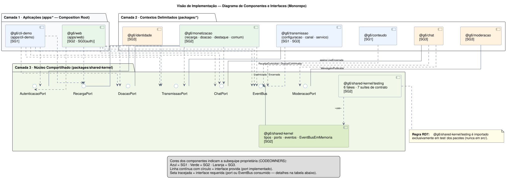
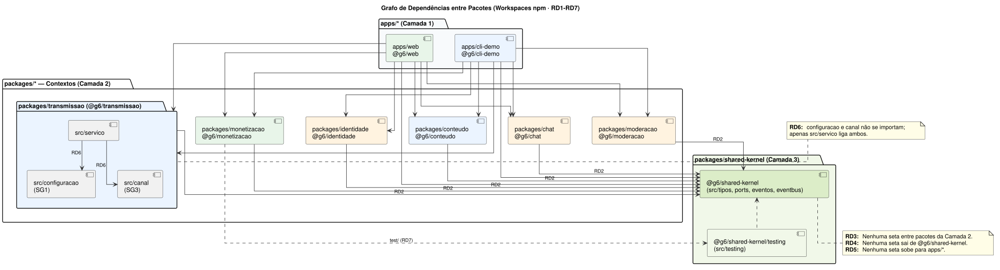

# 1.1.1.8. Visão de Implementação

> **Responsáveis:** Daniel de Oliveira Lira e Mateus Rodrigues Barreto (SubEquipe_02, [Ata S2E4_01](../../../Projeto/Atas/ata-G01-entrega-04.md), D02) · **Revisão cruzada:** SubEquipe_01 · **Issue:** [#8](https://github.com/UnBArqDsw2026-2-Turma01/2026.2-T01-_G6_ProjetoStreamingVideo_Entrega_04/issues/8) · **Status:** 🟡 em andamento, aguardando revisão cruzada

## Conteúdo

A Visão de Implementação descreve **como o código-fonte do sistema está organizado em módulos, componentes e arquivos** no ambiente de desenvolvimento (KRUCHTEN, 1995). Enquanto a [Visão Lógica](1.1.1.5.VisaoLogica.md) define a decomposição conceitual em contextos delimitados e as regras de dependência, esta visão concretiza essa estrutura no monorepo do [repositório de código](https://github.com/UnBArqDsw2026-2-Turma01/2026.2-T01-_G6_ProjetoStreamingVideo_Entrega_04_Codigo): workspaces npm, componentes UML com suas interfaces providas e requeridas (*ports* do `@g6/shared-kernel`), propriedade de arquivos (`CODEOWNERS`) e grafo de dependências entre pacotes.

| Fonte | O que forneceu | Situação no código |
| --- | --- | --- |
| Estrutura do monorepo (`package.json`, `packages/*`, `apps/*`, `CODEOWNERS`) | Organização dos workspaces, pontos de entrada e propriedade por subequipe | Na `main` ([`26c3290`](https://github.com/UnBArqDsw2026-2-Turma01/2026.2-T01-_G6_ProjetoStreamingVideo_Entrega_04_Codigo/tree/26c3290b6ff56ad2289044c8f8c24578b2fede58)) |
| `@g6/shared-kernel` (PRs [#26](https://github.com/UnBArqDsw2026-2-Turma01/2026.2-T01-_G6_ProjetoStreamingVideo_Entrega_04_Codigo/pull/26) e [#27](https://github.com/UnBArqDsw2026-2-Turma01/2026.2-T01-_G6_ProjetoStreamingVideo_Entrega_04_Codigo/pull/27)) | Definição dos 6 *ports*, DTOs, eventos, `EventBusEmMemoria`, 6 *fakes* e 7 suítes de contrato | Integrado na `main` |
| `@g6/monetizacao` (PRs [#28](https://github.com/UnBArqDsw2026-2-Turma01/2026.2-T01-_G6_ProjetoStreamingVideo_Entrega_04_Codigo/pull/28), [#31](https://github.com/UnBArqDsw2026-2-Turma01/2026.2-T01-_G6_ProjetoStreamingVideo_Entrega_04_Codigo/pull/31) e [#32](https://github.com/UnBArqDsw2026-2-Turma01/2026.2-T01-_G6_ProjetoStreamingVideo_Entrega_04_Codigo/pull/32)) | Implementações reais de `RecargaPort`, `DoacaoPort` e Decorator `MensagemDestacada` | Integrado na `main` |
| Evidência de dependências da Visão Lógica (<a href="assets/visao-logica/evidencias/ev-01-dependencias-monorepo.txt" target="_blank" rel="noopener">EV-01</a>) | Verificação estática das declarações de dependências dos `package.json` | Referenciada na seção 1.1.1.5 |

### Diagrama de componentes

O diagrama abaixo usa a notação de componentes da UML 2.5.1 (OMG, 2017, cap. 11) para mostrar os componentes executáveis do monorepo, os *ports* providos por cada contexto e os *ports*/eventos requeridos pelos demais componentes no cenário **CA-01 — Live com doação destacada**.



<p align="center"><sub><b>Figura 1</b> — Diagrama de componentes UML do monorepo, com interfaces providas e requeridas. Autoria: SubEquipe_02 (Daniel de Oliveira Lira e Mateus Rodrigues Barreto), 2026. Fonte editável: <a href="assets/visao-implementacao/visao-implementacao-componentes.puml" target="_blank" rel="noopener">visao-implementacao-componentes.puml</a> (PlantUML) · <a href="assets/visao-implementacao/visao-implementacao-componentes.png" target="_blank" rel="noopener">PNG</a>.</sub></p>

**Como ler.** Cada retângulo com ícone de componente representa um pacote npm do monorepo, colorido pela subequipe proprietária (azul: SG1; verde: SG2; laranja: SG3). As linhas contínuas ligadas a círculos representam **interfaces providas** (o componente implementa o *port* definido no contrato). As setas tracejadas apontando para os círculos representam **interfaces requeridas** (o componente consome o contrato sem importar a implementação concreta). A composição real das instâncias ocorre exclusivamente nos componentes da Camada 1 (`apps/web` e `apps/cli-demo`).

### Organização do monorepo

O repositório adota **npm workspaces** em TypeScript (Node.js ≥ 22, executado diretamente via `tsx`, sem etapa obrigatória de compilação prévia). A árvore lógica de diretórios separa aplicações de composição (`apps/`) de pacotes reutilizáveis de domínio e contrato (`packages/`):

```text
2026.2-T01-_G6_ProjetoStreamingVideo_Entrega_04_Codigo/
├── apps/
│   ├── cli-demo/                  # @g6/cli-demo — roteiro do CA-01 no terminal (SG1)
│   └── web/                       # @g6/web — servidor HTTP/SSE + página integrada (SG2; src/auth: SG3)
├── packages/
│   ├── shared-kernel/             # @g6/shared-kernel — tipos, ports, eventos, EventBus e testing/ (SG2)
│   ├── identidade/                # @g6/identidade — Chain of Responsibility de login e step-up (SG3)
│   ├── transmissao/               # @g6/transmissao — configuracao (SG1), canal (SG3) e servico (SG1)
│   ├── conteudo/                  # @g6/conteudo — Factory Method de UGC e geração de VOD (SG1)
│   ├── monetizacao/               # @g6/monetizacao — recarga, doacao, destaque e comum (SG2)
│   ├── chat/                      # @g6/chat — ChatRoom (Observer) e entrega moderada (SG3)
│   └── moderacao/                 # @g6/moderacao — AutoModPipeline de avaliação de mensagens (SG3)
├── .github/CODEOWNERS             # Mapeamento de propriedade por caminho para revisão de PRs
├── package.json                   # Definição dos workspaces e scripts raiz (typecheck, test, web, demo)
└── tsconfig.base.json             # Configuração estrita compartilhada de TypeScript
```

#### Propriedade dos pacotes (`CODEOWNERS`)

Cada pacote possui um dono explícito no arquivo `CODEOWNERS` para evitar conflitos de edição paralela e exigir aprovação dos responsáveis em cada Pull Request:

| Workspace | Caminho no repositório | Subequipe dona | Escopo interno principal | Issues de código |
| --- | --- | --- | --- | --- |
| `@g6/shared-kernel` | `packages/shared-kernel/` | SubEquipe_02 | `src/{tipos, ports, eventos, eventbus, testing}`, `test/` | [#3](https://github.com/UnBArqDsw2026-2-Turma01/2026.2-T01-_G6_ProjetoStreamingVideo_Entrega_04_Codigo/issues/3), [#4](https://github.com/UnBArqDsw2026-2-Turma01/2026.2-T01-_G6_ProjetoStreamingVideo_Entrega_04_Codigo/issues/4) |
| `@g6/identidade` | `packages/identidade/` | SubEquipe_03 | Cadeia de autenticação e `AutenticacaoService` | [#5](https://github.com/UnBArqDsw2026-2-Turma01/2026.2-T01-_G6_ProjetoStreamingVideo_Entrega_04_Codigo/issues/5) |
| `@g6/transmissao` | `packages/transmissao/` | SubEquipe_01 e SubEquipe_03 | `src/configuracao` (SG1), `src/canal` (SG3) e `src/servico` (SG1) | [#6](https://github.com/UnBArqDsw2026-2-Turma01/2026.2-T01-_G6_ProjetoStreamingVideo_Entrega_04_Codigo/issues/6), [#7](https://github.com/UnBArqDsw2026-2-Turma01/2026.2-T01-_G6_ProjetoStreamingVideo_Entrega_04_Codigo/issues/7), [#8](https://github.com/UnBArqDsw2026-2-Turma01/2026.2-T01-_G6_ProjetoStreamingVideo_Entrega_04_Codigo/issues/8) |
| `@g6/conteudo` | `packages/conteudo/` | SubEquipe_01 | Criadores de UGC (`RecordedVideoCreator`) e tratador de `LiveEncerrada` | [#9](https://github.com/UnBArqDsw2026-2-Turma01/2026.2-T01-_G6_ProjetoStreamingVideo_Entrega_04_Codigo/issues/9) |
| `@g6/monetizacao` | `packages/monetizacao/` | SubEquipe_02 | `src/comum` (`Carteira`), `src/recarga`, `src/doacao`, `src/destaque` | [#10](https://github.com/UnBArqDsw2026-2-Turma01/2026.2-T01-_G6_ProjetoStreamingVideo_Entrega_04_Codigo/issues/10), [#11](https://github.com/UnBArqDsw2026-2-Turma01/2026.2-T01-_G6_ProjetoStreamingVideo_Entrega_04_Codigo/issues/11), [#12](https://github.com/UnBArqDsw2026-2-Turma01/2026.2-T01-_G6_ProjetoStreamingVideo_Entrega_04_Codigo/issues/12) |
| `@g6/chat` | `packages/chat/` | SubEquipe_03 | `ChatRoom`, fila de quarentena e `ChatService` | [#13](https://github.com/UnBArqDsw2026-2-Turma01/2026.2-T01-_G6_ProjetoStreamingVideo_Entrega_04_Codigo/issues/13) |
| `@g6/moderacao` | `packages/moderacao/` | SubEquipe_03 | `AutoModPipeline` e `ModeracaoService` | [#14](https://github.com/UnBArqDsw2026-2-Turma01/2026.2-T01-_G6_ProjetoStreamingVideo_Entrega_04_Codigo/issues/14) |
| `@g6/cli-demo` | `apps/cli-demo/` | SubEquipe_01 | Ponto de entrada `src/main.ts` do CA-01 no terminal | [#15](https://github.com/UnBArqDsw2026-2-Turma01/2026.2-T01-_G6_ProjetoStreamingVideo_Entrega_04_Codigo/issues/15) |
| `@g6/web` | `apps/web/` | SubEquipe_02 (e SG3 em `src/auth`) | Servidor HTTP/SSE (`src/servidor.ts`), interface web e login (`src/auth`) | [#16](https://github.com/UnBArqDsw2026-2-Turma01/2026.2-T01-_G6_ProjetoStreamingVideo_Entrega_04_Codigo/issues/16), [#17](https://github.com/UnBArqDsw2026-2-Turma01/2026.2-T01-_G6_ProjetoStreamingVideo_Entrega_04_Codigo/issues/17) |

### Interfaces providas e requeridas

Todos os contratos entre componentes são definidos em `@g6/shared-kernel` (exportação raiz `.` para produção e `./testing` para *fakes* e suítes de conformidade). A tabela abaixo consolida a matriz de interfaces providas, requeridas e eventos de domínio por componente:

| Componente | Interfaces providas (*ports*) | Interfaces requeridas (*ports* / barramento) | Eventos publicados | Eventos assinados |
| --- | --- | --- | --- | --- |
| `@g6/shared-kernel` | `EventBus` (`EventBusEmMemoria`) e tipos/contratos base | Nenhuma (RD4) | — | — |
| `@g6/identidade` | `AutenticacaoPort` (`login`, `stepUp`) | Nenhuma | — | — |
| `@g6/transmissao` | `TransmissaoPort` (`abrir`, `encerrar`, `consultar`) | `EventBus` | `LiveIniciada`, `LiveEncerrada` | — |
| `@g6/conteudo` | *(nenhum port público no CA-01)* | `EventBus` | — | `LiveEncerrada` |
| `@g6/monetizacao` | `RecargaPort` (`ofertas`, `recarregar`, `consultar`), `DoacaoPort` (`doar`) | `TransmissaoPort`, `ChatPort`, `EventBus` | `RecargaConcluida`, `DoacaoConfirmada` | — |
| `@g6/chat` | `ChatPort` (`publicar`, `publicarDestacada`, `inscrever`) | `ModeracaoPort`, `EventBus` | `MensagemPublicada` | — |
| `@g6/moderacao` | `ModeracaoPort` (`avaliar`) | Nenhuma | — | — |
| `@g6/web` e `@g6/cli-demo` | *(pontos de entrada HTTP/SSE e CLI)* | Todos os 6 *ports* + `EventBus` | — | `LiveIniciada`, `LiveEncerrada`, `RecargaConcluida`, `DoacaoConfirmada`, `MensagemPublicada` |

**Pontos de destaque na implementação dos contratos:**
- **`RecargaPort` em dois tempos:** `recarregar` retorna `Resultado<CheckoutPendente, ErroRecarga>` sem creditar saldo; o crédito e a publicação de `RecargaConcluida` ocorrem apenas quando o aviso de pagamento passa pelo Proxy (`receberAviso`), mantendo o webhook fora do kernel.
- **`DoacaoPort` e regra D05:** `ServicoDoacao` consulta o criador da live via `TransmissaoPort.consultar`, monta o DTO `MensagemDestacada` via `montarMensagemDestacada` (`src/destaque`) e invoca `ChatPort.publicarDestacada`; caso o chat falhe, a doação permanece válida com `destaqueEntregue: false`.
- **Isolamento de erros no `EventBusEmMemoria`:** o barramento executa os tratadores em ordem com proteção contra reentrância (fila interna) e isola exceções por tratador (`try/catch` + `AggregateError`), impedindo que uma falha em um assinante interrompa os demais ou quebre a D05.

### Grafo de dependências

O grafo de dependências abaixo traduz as regras **RD1–RD7** definidas na [Visão Lógica](1.1.1.5.VisaoLogica.md) para o nível de workspaces e pastas reais do monorepo.



<p align="center"><sub><b>Figura 2</b> — Grafo de dependências entre workspaces do monorepo e subpastas críticas (RD1–RD7). Autoria: SubEquipe_02 (Daniel de Oliveira Lira e Mateus Rodrigues Barreto), 2026. Fonte editável: <a href="assets/visao-implementacao/visao-implementacao-dependencias.puml" target="_blank" rel="noopener">visao-implementacao-dependencias.puml</a> (PlantUML) · <a href="assets/visao-implementacao/visao-implementacao-dependencias.png" target="_blank" rel="noopener">PNG</a>.</sub></p>

**Situação da verificação automática (Fitness Function E2):** até o fechamento desta versão, a iniciativa extra **E2** ([código #18](https://github.com/UnBArqDsw2026-2-Turma01/2026.2-T01-_G6_ProjetoStreamingVideo_Entrega_04_Codigo/issues/18) · [1.3 Iniciativas Extras](../../1.3.IniciativasExtras.md)) encontra-se planejada e ainda não gera automaticamente o grafo de dependências no CI. A conformidade atual do grafo é sustentada por três mecanismos complementares:
1. Declarações explícitas de `dependencies` nos `package.json` de cada workspace (verificadas na evidência <a href="assets/visao-logica/evidencias/ev-01-dependencias-monorepo.txt" target="_blank" rel="noopener">EV-01</a>);
2. Verificação estática de tipos do TypeScript (`npm run typecheck`) em todo o monorepo;
3. Revisão cruzada obrigatória em Pull Requests guiada pelo `CODEOWNERS` e pelas suítes de contrato de `@g6/shared-kernel/testing`.

## O que mudou desde a E02/E03 e por quê

| Antes | Agora | Por quê | Evidência |
| --- | --- | --- | --- |
| **E02 (SG1):** Diagrama de Componentes C1–C4 restrito ao escopo da SubEquipe_01 (transmissão, conteúdo e playback) | Diagrama de componentes unificado com os 6 contextos das três subequipes, 2 aplicações (`apps/*`) e 1 *shared kernel* | A E04 integra o código real das três subequipes em um único sistema executável (CA-01) | [Diagrama de componentes E02](https://unbarqdsw2026-2-turma01.github.io/2026.2-T01-_G6_ProjetoStreamingVideo_Entrega_02/#/Base/Relatórios/1.1.1.SubEquipe_01/1.1.1.9.Extra.DiagramaComponentes.md) |
| **E03:** três repositórios independentes, sem contratos compartilhados e com duplicação de tipos (usuário, live, mensagem) | Monorepo único com npm workspaces e contratos centralizados em `@g6/shared-kernel` | Permitir compilação, testes e execução conjunta do CA-01 com propriedade clara por pasta (`CODEOWNERS`) | [`package.json`](https://github.com/UnBArqDsw2026-2-Turma01/2026.2-T01-_G6_ProjetoStreamingVideo_Entrega_04_Codigo/blob/26c3290b6ff56ad2289044c8f8c24578b2fede58/package.json) · [ADR-006](ADR/ADR-006-camadas-contextos-delimitados.md) |
| **E03 (SG2):** o chat local aplicava o Decorator da mensagem destacada e expunha `NotificadorChat` retornando `void` | `monetizacao/src/destaque` aplica o Decorator antes e entrega o DTO `MensagemDestacada` para `ChatPort.publicarDestacada` (SG3), retornando `Resultado<void>` | O chat passou a ser o da SG3 e a falha no chat precisou se tornar observável para testar a regra D05 com `FakeChat` | [PR #28](https://github.com/UnBArqDsw2026-2-Turma01/2026.2-T01-_G6_ProjetoStreamingVideo_Entrega_04_Codigo/pull/28) · [PR #32](https://github.com/UnBArqDsw2026-2-Turma01/2026.2-T01-_G6_ProjetoStreamingVideo_Entrega_04_Codigo/pull/32) |
| **E03 (SG2):** `processarRecarga` não possuía interface formal entre pacotes; proposta inicial da E04 previa `recarregar` devolvendo `Recibo` imediato | `RecargaPort` evoluído para fluxo em dois tempos (`ofertas`, `recarregar → CheckoutPendente`, `consultar → SituacaoRecarga`) com `FakeRecarga.confirmar()` nas suítes | Refletir fielmente o fluxo real de checkout + confirmação por Proxy da E03 sem vazar detalhes de webhook para o kernel | [PR #26](https://github.com/UnBArqDsw2026-2-Turma01/2026.2-T01-_G6_ProjetoStreamingVideo_Entrega_04_Codigo/pull/26) · [PR #27](https://github.com/UnBArqDsw2026-2-Turma01/2026.2-T01-_G6_ProjetoStreamingVideo_Entrega_04_Codigo/pull/27) · [PR #31](https://github.com/UnBArqDsw2026-2-Turma01/2026.2-T01-_G6_ProjetoStreamingVideo_Entrega_04_Codigo/pull/31) |
| **E03 (SG2):** frentes F1 (recarga) e F2 (doação) no mesmo repositório sem fronteira explícita de núcleo comum | Base compartilhada (`Carteira`, domínio financeiro) extraída para `packages/monetizacao/src/comum`, reutilizada por `recarga` e `doacao` | Garantir que a moeda creditada pela recarga seja a mesma debitada pela doação no CA-01 sem duplicar `Carteira` | [PR #31](https://github.com/UnBArqDsw2026-2-Turma01/2026.2-T01-_G6_ProjetoStreamingVideo_Entrega_04_Codigo/pull/31) · [PR #32](https://github.com/UnBArqDsw2026-2-Turma01/2026.2-T01-_G6_ProjetoStreamingVideo_Entrega_04_Codigo/pull/32) |

## Decisões e senso crítico

**Alternativas descartadas:**
- **Manter repositórios separados (multi-repo) com publicação de pacotes:** descartada porque exigiria versionamento manual de `@g6/shared-kernel` a cada ajuste de contrato, atrasando a integração em um prazo curto de entrega. O monorepo com npm workspaces permite alterar o contrato e validar todos os consumidores com um único `npm run typecheck`.
- **Etapa de build (`tsc` emitindo `dist/`) antes de cada execução:** descartada em favor da execução direta com `tsx`. Reduz atrito no desenvolvimento local, mas exige disciplina na execução de `npm run typecheck`, pois o `tsx` não bloqueia erros de tipagem em tempo de execução.

**Limitações e pontos críticos identificados:**
1. **Gargalo de coordenação no `@g6/shared-kernel`:** embora o *shared kernel* elimine acoplamento direto entre contextos (RD3), qualquer mudança em um *port* impacta simultaneamente quem provê, quem consome e o kit de testes (`fakes` e `suites`). Isso ficou evidente na revisão do `RecargaPort` (PR #26 → PR #27 → PR #31) e na ausência inicial da reexportação de `EventBusEmMemoria` em `src/index.ts`, detectada apenas quando `@g6/monetizacao` passou a consumir o pacote.
2. **Verificação de dependências ainda manual:** enquanto a fitness function da extra E2 ([código #18](https://github.com/UnBArqDsw2026-2-Turma01/2026.2-T01-_G6_ProjetoStreamingVideo_Entrega_04_Codigo/issues/18)) não estiver ativa no CI, violações às regras RD3–RD7 dependem de inspeção em revisão de PR e da disciplina nos `package.json`.
3. **Integração parcial dos pontos de entrada:** no recorte atual da `main`, `@g6/shared-kernel` e `@g6/monetizacao` já implementam seus contratos e passam nas suítes de conformidade, enquanto `apps/web` (#16) e `apps/cli-demo` (#15) e parte dos contextos das demais subequipes concluem a ligação final no *composition root*.

## Rastreabilidade

| Elemento desta seção | Origem (E01/E02/E03/E04) | Link |
| --- | --- | --- |
| Evolução dos componentes do sistema | E02, Diagrama de Componentes C1–C4 (SG1) | [Diagrama de componentes E02](https://unbarqdsw2026-2-turma01.github.io/2026.2-T01-_G6_ProjetoStreamingVideo_Entrega_02/#/Base/Relatórios/1.1.1.SubEquipe_01/1.1.1.9.Extra.DiagramaComponentes.md) |
| Decomposição em camadas × contextos e regras RD1–RD7 | E04, Visão Lógica e ADR-006 | [1.1.1.5 Visão Lógica](1.1.1.5.VisaoLogica.md) · [ADR-006](ADR/ADR-006-camadas-contextos-delimitados.md) |
| Contexto `transmissao` com dois donos (RD6) | E04, ADR-009 | [ADR-009](ADR/ADR-009-transmissao-contexto-dois-donos.md) |
| Contrato de integração, `EventBusEmMemoria`, fakes e suítes | E04, Issues #3 e #4 do código | [PR #26](https://github.com/UnBArqDsw2026-2-Turma01/2026.2-T01-_G6_ProjetoStreamingVideo_Entrega_04_Codigo/pull/26) · [PR #27](https://github.com/UnBArqDsw2026-2-Turma01/2026.2-T01-_G6_ProjetoStreamingVideo_Entrega_04_Codigo/pull/27) |
| Implementação de `monetizacao` (`RecargaPort`, `DoacaoPort`, `MensagemDestacada`) | E03 (F1–F3 da SG2) e E04 (Issues #10, #11, #12) | [PR #28](https://github.com/UnBArqDsw2026-2-Turma01/2026.2-T01-_G6_ProjetoStreamingVideo_Entrega_04_Codigo/pull/28) · [PR #31](https://github.com/UnBArqDsw2026-2-Turma01/2026.2-T01-_G6_ProjetoStreamingVideo_Entrega_04_Codigo/pull/31) · [PR #32](https://github.com/UnBArqDsw2026-2-Turma01/2026.2-T01-_G6_ProjetoStreamingVideo_Entrega_04_Codigo/pull/32) |
| Mapeamento dos artefatos de implementação para nós físicos | E04, Visão de Implantação | [1.1.1.7 Visão de Implantação](1.1.1.7.VisaoImplantacao.md) |

## Referências

- CLEMENTS, Paul et al. *Documenting Software Architectures: Views and Beyond*. 2. ed. Boston: Addison-Wesley, 2010. (Visão de módulos e decomposição em componentes e dependências.)
- EVANS, Eric. *Domain-Driven Design: Tackling Complexity in the Heart of Software*. Boston: Addison-Wesley, 2003. Cap. 14 (*Bounded Context* e *Shared Kernel*).
- FORD, Neal; PARSONS, Rebecca; KUA, Patrick. *Building Evolutionary Architectures*. O'Reilly, 2017. (*Fitness functions* arquiteturais.)
- KRUCHTEN, Philippe. Architectural Blueprints — The "4+1" View Model of Software Architecture. *IEEE Software*, v. 12, n. 6, p. 42–50, 1995. (Fundamentação da Visão de Implementação / Desenvolvimento.)
- OBJECT MANAGEMENT GROUP (OMG). *Unified Modeling Language (UML)*, versão 2.5.1. 2017. Cap. 11, Components. Disponível em: https://www.omg.org/spec/UML/2.5.1.
- Modelo de documento de arquitetura de software indicado na diretriz: [UFRN/DCA](https://www.dca.ufrn.br/~anderson/FTP/dca0120/modelodocarquiteturasoftware.doc).

## Histórico de Versões

| Versão | Data | Descrição | Autor(es) | Revisor(es) |
| --- | --- | --- | --- | --- |
| 0.1 | 09/11/2026 | Estrutura inicial da página, conforme o planejamento da Entrega 04 | Lucas Andrade Zanetti | — |
| 1.0 | 21/11/2026 | Primeira versão completa: diagrama de componentes UML com interfaces providas e requeridas (Figura 1), organização do monorepo e tabela de `CODEOWNERS`, matriz de *ports* e eventos, grafo de dependências RD1–RD7 (Figura 2), mudanças desde a E02/E03, senso crítico, rastreabilidade e referências | Daniel de Oliveira Lira, Mateus Rodrigues Barreto | Pendente (SubEquipe_01) |