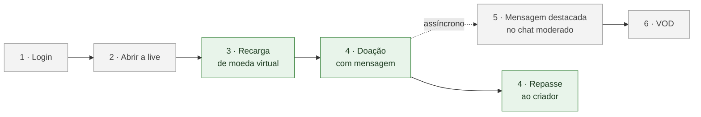

# Organização da Entrega 04 — SubEquipe_02

> **Foco do grupo**: DAS + IA Generativa ([Ata G01, D01](/Projeto/Atas/ata-G01-entrega-04.md)).
>
> **Missão da SubEquipe_02** ([Ata G01, D02](/Projeto/Atas/ata-G01-entrega-04.md)): Visão de Implementação e Visão de Implantação no DAS; no código, o shared kernel (primeiro), a monetização e a página web integrada.
>
> **Prazo Interno**: 21/11/2026
>
> **Prazo Equipe**: 22/11/2026
>
> **Entrega**: 23/11/2026
>
> **Status**: 🟡 Em andamento.

---

## 1. O que é a entrega

Na Entrega 03, cada subequipe aplicou padrões GoF em um código próprio. Agora o grupo junta os três códigos em **um único sistema** e o descreve em um **Documento de Arquitetura de Software (DAS)**, no modelo indicado pela professora (template UFRN/DCA, derivado do SAD do RUP, organizado pelo modelo de visões 4+1).

A evidência de que a arquitetura existe de fato é o cenário **CA-01 — Live com doação destacada** rodando no [repositório de código](https://github.com/UnBArqDsw2026-2-Turma01/2026.2-T01-_G6_ProjetoStreamingVideo_Entrega_04_Codigo). O [planejamento geral](/Projeto/Planejamento.md) define a missão de cada subequipe; a divisão por integrante da SubEquipe_02 é a deste documento.

### O que a SubEquipe_02 entrega

| # | Entregável | Descrição | Obrigatório |
| -- | -- | -- | -- |
| 1 | **Visão de Implementação** | Diagrama de componentes do monorepo, interfaces providas e requeridas (ports) e dependências entre pacotes ([1.1.1.8](/Base/Relatórios/1.1.1.DAS/1.1.1.8.VisaoImplementacao.md), [#8](https://github.com/UnBArqDsw2026-2-Turma01/2026.2-T01-_G6_ProjetoStreamingVideo_Entrega_04/issues/8)) | ✅ |
| 2 | **Visão de Implantação** | Diagrama de implantação: navegador, servidor Node e processadores de pagamento em modo de teste ([1.1.1.7](/Base/Relatórios/1.1.1.DAS/1.1.1.7.VisaoImplantacao.md), [#7](https://github.com/UnBArqDsw2026-2-Turma01/2026.2-T01-_G6_ProjetoStreamingVideo_Entrega_04/issues/7)) | ✅ |
| 3 | **Código** | Shared kernel, monetização (recarga, doação e destaque) e página web integrada, com testes | ✅ |
| 4 | **Relato de IA** | Relato individual, crítico e fundamentado, de cada integrante (Foco_02) | ✅ |
| 5 | **Página de Reutilização** | Justificativa da escolha do foco DAS e reúso presente no trabalho ([1.1.2](/Base/Relatórios/1.1.2.Reutilizacao.md), [#9](https://github.com/UnBArqDsw2026-2-Turma01/2026.2-T01-_G6_ProjetoStreamingVideo_Entrega_04/issues/9)) | ✅ (o template não permite omitir seções) |
| 6 | **Visão de Dados** | Entidades do domínio e onde os dados vivem em cada contexto ([1.1.1.9](/Base/Relatórios/1.1.1.DAS/1.1.1.9.VisaoDados.md), [#9](https://github.com/UnBArqDsw2026-2-Turma01/2026.2-T01-_G6_ProjetoStreamingVideo_Entrega_04/issues/9)) | ✅ |
| 7 | **Vídeo explicativo** | Cada responsável pode gravar um vídeo explicando o próprio diagrama, se for aplicável ([Ata S2E4_01, D08](./ata-S2E4-01-2026-11-11.md)) | ⭐ Opcional |
| 8 | **Extras** | E6 Docker Compose, E7 C4 como código e E9 shared kernel documentado | ⭐ Pode agregar à menção |

Contribuições para o grupo todo: linhas da SubEquipe_02 na [matriz de rastreabilidade](/Base/Relatórios/1.1.1.DAS/1.1.1.12.Rastreabilidade.md) ([#20](https://github.com/UnBArqDsw2026-2-Turma01/2026.2-T01-_G6_ProjetoStreamingVideo_Entrega_04/issues/20)) e consolidação do quadro de [participações](/Base/1.2.Participacoes.md) ([#15](https://github.com/UnBArqDsw2026-2-Turma01/2026.2-T01-_G6_ProjetoStreamingVideo_Entrega_04/issues/15)).

---

## 2. O cenário CA-01 e a parte da SubEquipe_02

| Passo | O que acontece | Padrões (origem na E03) | Quem |
| -- | -- | -- | -- |
| 3 | Espectador recarrega moeda virtual: preço em camadas, meio de pagamento escolhido e confirmação protegida | Decorator · Adapter · Proxy | SubEquipe_02 |
| 4 | Espectador doa com mensagem; o repasse ao criador acontece em paralelo | Facade + Mediator | SubEquipe_02 |
| 5 | A mensagem destacada (Decorator, SubEquipe_02) entra no chat e passa pela moderação | Decorator → Observer + AutoMod | SubEquipe_02 → SubEquipe_03 |

**Regra herdada da E03**: a mensagem destacada é uma notificação assíncrona. Se o chat falhar, a doação e o repasse continuam válidos ([Ata S2_02, D05 da E03](https://unbarqdsw2026-2-turma01.github.io/2026.2-T01-_G6_ProjetoStreamingVideo_Entrega_03/#/Projeto/Atas/Atas_Sg2/ata-S2-02-2026-10-10)). No contrato, isso aparece em `ComprovanteDoacao.destaqueEntregue`.

**Mudança em relação à E03**: o chat agora é da SubEquipe_03. A SubEquipe_02 aplica o Decorator da mensagem destacada **antes** e envia a mensagem já decorada ao chat da SubEquipe_03; do chat da SubEquipe_02 na E03, só a criação da mensagem decorada é reaproveitada. O Mediator da doação continua ([Ata S2E4_01, D04](./ata-S2E4-01-2026-11-11.md)).

---

## 3. Código: o que a SubEquipe_02 leva para o monorepo

| Caminho | Conteúdo | Padrões (origem na E03) | Issue |
| -- | -- | -- | -- |
| `packages/shared-kernel` | Contrato de integração: tipos, ports, eventos, EventBus, fakes e suítes de contrato | — | [#3](https://github.com/UnBArqDsw2026-2-Turma01/2026.2-T01-_G6_ProjetoStreamingVideo_Entrega_04_Codigo/issues/3) · [#4](https://github.com/UnBArqDsw2026-2-Turma01/2026.2-T01-_G6_ProjetoStreamingVideo_Entrega_04_Codigo/issues/4) |
| `packages/monetizacao/src/recarga` | Recarga · `RecargaPort` | Decorator · Adapter · Proxy (F1 da E03) | [#10](https://github.com/UnBArqDsw2026-2-Turma01/2026.2-T01-_G6_ProjetoStreamingVideo_Entrega_04_Codigo/issues/10) |
| `packages/monetizacao/src/doacao` | Doação e repasse · `DoacaoPort`; consome `ChatPort` | Facade + Mediator\* (F2 da E03) | [#11](https://github.com/UnBArqDsw2026-2-Turma01/2026.2-T01-_G6_ProjetoStreamingVideo_Entrega_04_Codigo/issues/11) |
| `packages/monetizacao/src/destaque` | Mensagem destacada | Decorator (F3 da E03) | [#12](https://github.com/UnBArqDsw2026-2-Turma01/2026.2-T01-_G6_ProjetoStreamingVideo_Entrega_04_Codigo/issues/12) |
| `apps/web` (exceto `src/auth`) | Página integrada do CA-01, evolução da página da E03 | — | [#16](https://github.com/UnBArqDsw2026-2-Turma01/2026.2-T01-_G6_ProjetoStreamingVideo_Entrega_04_Codigo/issues/16) |

\* Mediator é comportamental; na E03 foi registrado como extra.

### Pontos de integração com as outras subequipes

| Ponto | Provê | Consome | Observação |
| -- | -- | -- | -- |
| Contrato e fakes (#3, #4) | SubEquipe_02 | Todos os pacotes | Aguarda a confirmação das outras subequipes nos PRs #26 e #27; congelado no M1 do grupo; depois, mudança só com issue `contrato` e aprovação das subequipes afetadas |
| `RecargaPort` · `DoacaoPort` | SubEquipe_02 (monetização) | `apps/web`, `apps/cli-demo` | Ver pendência P1 |
| `ChatPort.publicarDestacada` | SubEquipe_03 (chat) | SubEquipe_02 (doação) | Recebe a mensagem já decorada pela SubEquipe_02; testar contra o `FakeChat` configurado para falhar |
| Destaque → doação | SubEquipe_02 (#12) | SubEquipe_02 (#11) | Pela ordem do guia, #12 vem antes de #11 |
| Login na página web | SubEquipe_03 (`apps/web/src/auth`, #17) | SubEquipe_02 (`apps/web`) | A página web é da SubEquipe_02, exceto o login |

### Iniciativas extras

| # | Iniciativa | Issue | Situação |
| -- | -- | -- | -- |
| E6 | Docker Compose: a Visão de Implantação executável (`docker compose up` sobe a página web) | [código #20](https://github.com/UnBArqDsw2026-2-Turma01/2026.2-T01-_G6_ProjetoStreamingVideo_Entrega_04_Codigo/issues/20) | ⬜ Planejada |
| E7 | Diagramas C4 como código, com a correspondência C4 ↔ visões 4+1 | [#22](https://github.com/UnBArqDsw2026-2-Turma01/2026.2-T01-_G6_ProjetoStreamingVideo_Entrega_04/issues/22) | ⬜ Planejada |
| E9 | Shared kernel documentado (o mesmo contrato reutilizado por vários contextos) | [código #22](https://github.com/UnBArqDsw2026-2-Turma01/2026.2-T01-_G6_ProjetoStreamingVideo_Entrega_04_Codigo/issues/22) | ⬜ Planejada |

As extras só entram na página [1.3](/Base/1.3.IniciativasExtras.md) com comprobatório.

---

## 4. Divisão de responsabilidades

Divisão confirmada na reunião S2E4_01 ([Ata S2E4_01, D01 e D02](./ata-S2E4-01-2026-11-11.md)).

**Regras da divisão:**
1. Todo integrante participa de **pelo menos um artefato de Visão** e do **código**.
2. As duplas desta entrega são **inéditas**: **Davi + Pedro** e **Daniel + Mateus**. Pedro e Daniel já trabalharam juntos na E02 e na E03, por isso não formam dupla nem revisam os PRs um do outro.
3. A dupla revisa os PRs internos uma da outra pessoa; cada integrante faz ainda uma revisão cruzada de outra subequipe.

### 4.1. Duplas

| Dupla | Visão | Código | Extras | Por que essa combinação |
| -- | -- | -- | -- | -- |
| 🟩 **Davi + Pedro** | **Visão de Implantação** | Monetização: recarga (Davi) e doação (Pedro) | E6 Docker Compose (Pedro) · E7 C4 (Davi) | Os dois cuidam da parte do sistema que fala com o mundo externo: Davi integrou o Mercado Pago e o Stripe na E03, que são nós externos da implantação, e Pedro tem a implantação executável (E6). No código, os dois trabalham no mesmo pacote |
| 🟦 **Daniel + Mateus** | **Visão de Implementação** | Shared kernel (#3 e #4, já em andamento), destaque (Mateus) e composição dos módulos na página web | E9 shared kernel documentado (Daniel) | A Visão de Implementação descreve exatamente o que os dois estão construindo: os componentes do monorepo e as interfaces (ports) que eles definiram no contrato |

### 4.2. Divisão por integrante

| Membro | Visão | Código | Revisão cruzada (outra subequipe) | Extra | Outros |
| -- | -- | -- | -- | -- | -- |
| **Davi Severiano Freitas** | Implantação (com Pedro): processadores de pagamento externos, configuração e senso crítico | Recarga (#10) · apoio à integração da recarga na página web | Visão Lógica (SubEquipe_01, [#5](https://github.com/UnBArqDsw2026-2-Turma01/2026.2-T01-_G6_ProjetoStreamingVideo_Entrega_04/issues/5)) | E7 · C4 como código | Coordenação · linhas da SubEquipe_02 na rastreabilidade (#20) · consolidação de 1.2 Participações (#15) |
| **Pedro Henrique Freire Rodrigues** | Implantação (com Davi): diagrama de implantação e nós | Doação e repasse, com o Mediator ligado ao `ChatPort` da SubEquipe_03 (#11) | Tamanho e Desempenho ([#10](https://github.com/UnBArqDsw2026-2-Turma01/2026.2-T01-_G6_ProjetoStreamingVideo_Entrega_04/issues/10)) | E6 · Docker Compose | — |
| **Daniel de Oliveira Lira** | Implementação (com Mateus): interfaces providas e requeridas e grafo de dependências | EventBus, fakes e suítes de contrato (#4, [PR #27](https://github.com/UnBArqDsw2026-2-Turma01/2026.2-T01-_G6_ProjetoStreamingVideo_Entrega_04_Codigo/pull/27)) · manutenção do shared kernel · composição dos módulos reais na página web (com Mateus) | Metas e Restrições ([#4](https://github.com/UnBArqDsw2026-2-Turma01/2026.2-T01-_G6_ProjetoStreamingVideo_Entrega_04/issues/4)) | E9 · shared kernel documentado | Página de Reutilização (#9) |
| **Mateus Rodrigues Barreto** | Implementação (com Daniel): diagrama de componentes e organização do monorepo | Contrato (#3, [PR #26](https://github.com/UnBArqDsw2026-2-Turma01/2026.2-T01-_G6_ProjetoStreamingVideo_Entrega_04_Codigo/pull/26)) · destaque (#12) · página web integrada (#16) | Introdução e Representação Arquitetural ([#3](https://github.com/UnBArqDsw2026-2-Turma01/2026.2-T01-_G6_ProjetoStreamingVideo_Entrega_04/issues/3)) | — | Capturas de tela para o README e o DAS |
| **Todos** | — | — | — | — | Relato de IA · linhas no registro de prompts · *Versionamentos* no mesmo PR de cada contribuição · a própria linha em 1.2 Participações ([moldes](./moldes-contribuicao.md)) |

**Visão de Dados:** os quatro integrantes; a divisão interna será combinada nas próximas reuniões ([Ata S2E4_01, D03](./ata-S2E4-01-2026-11-11.md)).

**Ajuste com o grupo:** no [planejamento geral](/Projeto/Planejamento.md), Davi aparece na Visão de Implementação (#8) e Pedro na de Implantação (#7). Com esta divisão, as issues precisam ser reatribuídas: #8 para Daniel e Mateus, e #7 para Pedro e Davi.

A divisão **não é estanque**: todos trabalham nos mesmos repositórios e podem colaborar com as outras partes.

---

## 5. Cronograma sugerido

Na reunião S2E4_01, a subequipe decidiu não fixar datas por tarefa por enquanto ([Ata S2E4_01, D07](./ata-S2E4-01-2026-11-11.md)). O que está combinado:

| Período | Meta | Responsável |
| -- | -- | -- |
| Até 16/11 (reunião S2E4_02) | Confirmação do contrato pelas outras subequipes (#3, #4); código da E03 migrado para o monorepo (`recarga`, `doacao` e `destaque`); issues reatribuídas; visões de Implementação e de Implantação iniciadas e, de preferência, terminadas | Todos (ver os encaminhamentos da ata) |
| De 16/11 a 19/11 | Pacotes adaptados ao contrato e testados; página web compondo os módulos; Visão de Dados; revisões cruzadas; relatos de IA; extras | A combinar na reunião S2E4_02 |
| 20/11 | Feriado: nenhuma tarefa prevista | — |
| **21/11/2026** | **Prazo interno**: tudo da SubEquipe_02 pronto e revisado, inclusive os relatos de IA | Todos |
| **22/11/2026** | **Prazo da equipe**: congelamento do grupo | Todos |
| **23/11/2026** | **Entrega**: envio no Aprender3; apresentação do G6 às 08h50, só com os representantes | Representantes |

---

## 6. Estudo

Cada integrante estuda o conteúdo da própria visão, com apoio dos slides e das aulas do módulo de Arquitetura de Software e do material complementar.

| Dupla | Conteúdo a estudar |
| -- | -- |
| Davi + Pedro | Modelo 4+1 · Visão de Implantação (diagrama de implantação UML: nós, ambientes de execução, artefatos e comunicação) · notação C4 (contexto e contêineres) |
| Daniel + Mateus | Modelo 4+1 · Visão de Implementação (diagrama de componentes UML: componentes, interfaces providas e requeridas, dependências) · *Shared Kernel* e contextos delimitados de *Domain-Driven Design* |
| Todos | Template do DAS (UFRN/DCA) · estilos arquiteturais (camadas, orientado a eventos) |

Referências de base:

> KRUCHTEN, Philippe. Architectural Blueprints — The "4+1" View Model of Software Architecture. **IEEE Software**, v. 12, n. 6, p. 42–50, 1995.
>
> EVANS, Eric. **Domain-Driven Design: Tackling Complexity in the Heart of Software**. Boston: Addison-Wesley, 2003.

---

## 7. Regras

| Regra | Detalhe |
| -- | -- |
| **Linguagem** | TypeScript, Node.js 22 ou superior, sem etapa de build (roda com `tsx`) |
| **Repositórios** | Código e documentação compartilhados pelo grupo; nada direto na `main`; PR com `Closes #N` e revisão da dupla |
| **Contrato** | Um pacote importa só `@g6/shared-kernel`; só `apps/*` compõem módulos reais; mudança no contrato depois do M1 exige issue `contrato` |
| **Código da E03** | Entra em dois commits: cópia literal (`chore(<pacote>): import from <repo>@<sha>`) e adaptação (`refactor`) |
| **Commits** | Conventional Commits em inglês, com o pacote como escopo; a mensagem é comprobatório, então diga o que foi feito |
| **Diagramas** | Fonte `.puml` versionada + imagem `.svg` + legenda + elo com o artefato anterior |
| **Páginas** | Toda página com "O que mudou desde a E02/E03 e por quê", senso crítico com ao menos uma limitação, rastreabilidade, referências e histórico de versões |
| **Anonimização** | Nada do nome real da plataforma de referência, inclusive em código, commits e capturas de tela |
| **Segredos** | Credenciais dos processadores de pagamento só em `.env`; por padrão, o processador simulado |

---

## 8. Pendências

| # | Pendência | Por que importa | Encaminhamento |
| -- | -- | -- | -- |
| P1 | `RecargaPort.recarregar` devolve um `Recibo` com a moeda **já creditada** | Serve ao processador simulado, que aprova na hora, mas não ao checkout do Mercado Pago e do Stripe, que fica pendente até o pagamento e é confirmado pelo Proxy | Decidir antes do congelamento do contrato: (a) o CA-01 usa o simulado pelo port, e os processadores reais ficam como fluxo extra da página web; ou (b) propor no #3 um resultado que admita checkout pendente |
| P2 | Confirmação do contrato pelas outras subequipes | O contrato escolheu entre decisões diferentes das subequipes na E03 | Mateus e Daniel cobram a revisão nos PRs #26 e #27 |
| P3 | Reatribuição das issues #7, #8 e #9 | A divisão interna troca os donos sugeridos no planejamento geral | Davi, até 16/11 |
| P4 | Participação de todos na Visão Lógica | Não está claro se todo integrante precisa participar da visão obrigatória | Davi pergunta à professora |

Pendências resolvidas na reunião S2E4_01: responsável pela Visão de Dados (D03), vídeo (D08) e cronograma (D07).

---

## 9. Checklist da SubEquipe_02

- [ ] Contrato e fakes na `main` (#3, #4)
- [ ] Recarga, doação e destaque com testes verdes, expostos pelos ports (#10, #11, #12)
- [ ] Página web integrada rodando o CA-01 (#16)
- [ ] Visão de Implementação com diagrama de componentes, interfaces e dependências (#8)
- [ ] Visão de Implantação com diagrama de implantação (#7)
- [ ] Página de Reutilização (#9)
- [ ] Visão de Dados com o modelo de dados e onde os dados vivem em cada contexto (#9)
- [ ] Revisões cruzadas feitas (quatro) e recebidas nas nossas páginas
- [ ] Linhas da SubEquipe_02 na matriz de rastreabilidade (#20)
- [ ] Relatos de IA dos quatro integrantes (#13) e linhas no registro de prompts
- [ ] Versionamentos com todos os integrantes; 1.2 Participações consolidada (#15)
- [ ] Extras com comprobatório na 1.3 (E6, E7, E9) ou registradas como não realizadas
- [ ] Cada integrante com pelo menos uma Visão e um item de código comprovados por commit ou PR
- [ ] Capturas de tela no README do código

---

## 10. Reuniões da subequipe

| Reunião | Data | Pauta | Ata |
| -- | -- | -- | -- |
| S2E4_01 | 11/11/2026 | Abertura: planejamento geral, shared kernel, integração com o chat, divisão em duplas, Reutilização, Visão de Dados, prazos | [Ata S2E4_01](./ata-S2E4-01-2026-11-11.md) |
| S2E4_02 | 16/11/2026 | Acompanhamento: migração do código, issues e visões | A preencher |

---

## Histórico de Versões

| Versão | Data | Descrição | Autor(es) | Revisor(es) |
| -- | -- | -- | -- | -- |
| 1.0 | 11/11/2026 | Criação do documento de organização da SubEquipe_02 para a Entrega 04: entregáveis, cenário CA-01, código, duplas inéditas (Davi + Pedro e Daniel + Mateus), cronograma sugerido, estudo, regras, pendências e checklist, com as decisões da reunião S2E4_01 (Visão de Dados com os quatro integrantes, Decorator antes do chat, vídeo opcional, prazos e próxima reunião) | Davi Severiano Freitas | |