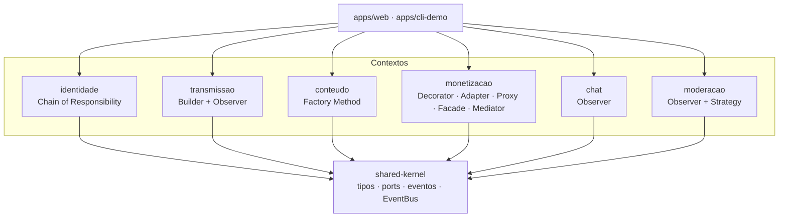

# Planejamento da Entrega 04

> Versão em PDF: [planejamento-entrega-04.pdf](Projeto/assets/planejamento-entrega-04.pdf ':ignore'). Decisões da reunião de abertura ([ata](/Projeto/Atas/ata-G01-entrega-04.md)): **foco DAS aprovado** (D01), divisão por subequipe aprovada com ressalvas (D02), TypeScript mantido (D07) e integração por shared kernel (D08). **Pendentes:** confirmar as datas no Aprender3 (D03), horário de congelamento (D04) e próxima reunião (D05). A parte de **vídeo** deste plano deve ser desconsiderada: a demonstração será ao vivo (D06).

## Em uma página

- **Foco: DAS + IA Generativa.** Os três códigos da Entrega 03 viram uma arquitetura única, com rastro até as Entregas 01–03.
- **Visões:** Lógica (SubEquipe_01, obrigatória) + Implementação (SubEquipe_02) + Processos (SubEquipe_03); a Implantação é reforço.
- **Algo rodando:** monorepo que executa o cenário **CA-01 — Live com doação destacada**.
- **Cada subequipe** é dona de uma visão, de uma fatia do código e de um extra. **Cada integrante** escreve o próprio relato de IA.
- **Prazo rígido:** congelamento em **D-1** (D = data de entrega no Aprender3).

## 1. Por que DAS e não Reutilização

| Critério | DAS + IA Generativa | Reutilização + IA Generativa |
| --- | --- | --- |
| Material existente | Modelos da E02, padrões GoF e três códigos da E03 organizados em visões | Exemplo da diretriz é React; nosso código é TypeScript/Node sem React |
| Evidência executável | Integrar o que existe e rodar um fluxo ponta a ponta | Criar componentes reutilizáveis praticamente do zero |
| Rastreabilidade | Requisito (E01) → modelo (E02) → padrão (E03) → pacote (E04) | Fraca com as entregas anteriores |
| Risco | Virar só documento; mitigação: CA-01 rodando e fitness functions (E2) | Retrabalho grande |

## 2. Arquitetura-alvo

Estilo: **camadas + contextos delimitados**, integrados por um **Shared Kernel** (Evans, *Domain-Driven Design*, cap. 14): um pacote pequeno com tipos comuns, *ports* (interfaces) e eventos. Cada contexto só conhece esse contrato e é desenvolvido e testado contra *fakes*; a composição real acontece em `apps/`.

### Cenário arquitetural CA-01

| # | Passo | Padrão (E03) | Dono |
| --- | --- | --- | --- |
| 1 | Criador e espectador fazem login | Chain of Responsibility | SubEquipe_03 |
| 2 | Criador abre a live por preset; seguidores são notificados | Builder + Director → Observer | SubEquipe_01 + SubEquipe_03 |
| 3 | Espectador recarrega moeda virtual | Decorator · Adapter · Proxy | SubEquipe_02 |
| 4 | Espectador doa com mensagem; repasse em paralelo | Facade + Mediator | SubEquipe_02 |
| 5 | Mensagem destacada passa pela moderação e chega ao chat | Decorator → Observer + AutoMod | SubEquipe_02 → SubEquipe_03 |
| 6 | Live encerrada vira VOD | Factory Method | SubEquipe_01 |

## 3. Divisão por subequipe

| Integrante | DAS | Código | Extra |
| --- | --- | --- | --- |
| **🔵 SubEquipe_01** | | | |
| Lucas Andrade Zanetti | Coordenação; seções 1 e 2 ([#3](https://github.com/UnBArqDsw2026-2-Turma01/2026.2-T01-_G6_ProjetoStreamingVideo_Entrega_04/issues/3)) | Monorepo ([código #2](https://github.com/UnBArqDsw2026-2-Turma01/2026.2-T01-_G6_ProjetoStreamingVideo_Entrega_04_Codigo/issues/2)) | CI ([código #19](https://github.com/UnBArqDsw2026-2-Turma01/2026.2-T01-_G6_ProjetoStreamingVideo_Entrega_04_Codigo/issues/19)) · rastreabilidade ([#20](https://github.com/UnBArqDsw2026-2-Turma01/2026.2-T01-_G6_ProjetoStreamingVideo_Entrega_04/issues/20)) |
| Matheus Lemes Amaral | Visão Lógica ([#5](https://github.com/UnBArqDsw2026-2-Turma01/2026.2-T01-_G6_ProjetoStreamingVideo_Entrega_04/issues/5)) | conteudo ([código #9](https://github.com/UnBArqDsw2026-2-Turma01/2026.2-T01-_G6_ProjetoStreamingVideo_Entrega_04_Codigo/issues/9)) | Fitness functions ([código #18](https://github.com/UnBArqDsw2026-2-Turma01/2026.2-T01-_G6_ProjetoStreamingVideo_Entrega_04_Codigo/issues/18)) |
| Pedro Druck Montalvão Reis | Seções 3 e 4 ([#4](https://github.com/UnBArqDsw2026-2-Turma01/2026.2-T01-_G6_ProjetoStreamingVideo_Entrega_04/issues/4)) | Revisões de conteudo/transmissao | ADRs ([#19](https://github.com/UnBArqDsw2026-2-Turma01/2026.2-T01-_G6_ProjetoStreamingVideo_Entrega_04/issues/19)) |
| Heitor Macedo Ricardo | Seção 10 ([#10](https://github.com/UnBArqDsw2026-2-Turma01/2026.2-T01-_G6_ProjetoStreamingVideo_Entrega_04/issues/10)) | transmissao ([código #6](https://github.com/UnBArqDsw2026-2-Turma01/2026.2-T01-_G6_ProjetoStreamingVideo_Entrega_04_Codigo/issues/6), [código #8](https://github.com/UnBArqDsw2026-2-Turma01/2026.2-T01-_G6_ProjetoStreamingVideo_Entrega_04_Codigo/issues/8)) · cli-demo ([código #15](https://github.com/UnBArqDsw2026-2-Turma01/2026.2-T01-_G6_ProjetoStreamingVideo_Entrega_04_Codigo/issues/15)) | Benchmark ([código #21](https://github.com/UnBArqDsw2026-2-Turma01/2026.2-T01-_G6_ProjetoStreamingVideo_Entrega_04_Codigo/issues/21)) |
| **🟢 SubEquipe_02** | | | |
| Davi Severiano Freitas | Visão de Implementação ([#8](https://github.com/UnBArqDsw2026-2-Turma01/2026.2-T01-_G6_ProjetoStreamingVideo_Entrega_04/issues/8)) | recarga ([código #10](https://github.com/UnBArqDsw2026-2-Turma01/2026.2-T01-_G6_ProjetoStreamingVideo_Entrega_04_Codigo/issues/10)) | C4 ([#22](https://github.com/UnBArqDsw2026-2-Turma01/2026.2-T01-_G6_ProjetoStreamingVideo_Entrega_04/issues/22)) |
| Daniel de Oliveira Lira | Seção 9 + página 1.1.2 ([#9](https://github.com/UnBArqDsw2026-2-Turma01/2026.2-T01-_G6_ProjetoStreamingVideo_Entrega_04/issues/9)) | **shared-kernel** ([código #3](https://github.com/UnBArqDsw2026-2-Turma01/2026.2-T01-_G6_ProjetoStreamingVideo_Entrega_04_Codigo/issues/3), [código #4](https://github.com/UnBArqDsw2026-2-Turma01/2026.2-T01-_G6_ProjetoStreamingVideo_Entrega_04_Codigo/issues/4)) | TypeDoc ([código #22](https://github.com/UnBArqDsw2026-2-Turma01/2026.2-T01-_G6_ProjetoStreamingVideo_Entrega_04_Codigo/issues/22)) |
| Mateus Rodrigues Barreto | Screenshots e vídeo ([#14](https://github.com/UnBArqDsw2026-2-Turma01/2026.2-T01-_G6_ProjetoStreamingVideo_Entrega_04/issues/14)) | destaque ([código #12](https://github.com/UnBArqDsw2026-2-Turma01/2026.2-T01-_G6_ProjetoStreamingVideo_Entrega_04_Codigo/issues/12)) · web ([código #16](https://github.com/UnBArqDsw2026-2-Turma01/2026.2-T01-_G6_ProjetoStreamingVideo_Entrega_04_Codigo/issues/16)) | — |
| Pedro Henrique Freire Rodrigues | Visão de Implantação ([#7](https://github.com/UnBArqDsw2026-2-Turma01/2026.2-T01-_G6_ProjetoStreamingVideo_Entrega_04/issues/7)) | doação ([código #11](https://github.com/UnBArqDsw2026-2-Turma01/2026.2-T01-_G6_ProjetoStreamingVideo_Entrega_04_Codigo/issues/11)) | Docker Compose ([código #20](https://github.com/UnBArqDsw2026-2-Turma01/2026.2-T01-_G6_ProjetoStreamingVideo_Entrega_04_Codigo/issues/20)) |
| **🟠 SubEquipe_03** | | | |
| Hugo Freitas Silva | Seção 11 ([#11](https://github.com/UnBArqDsw2026-2-Turma01/2026.2-T01-_G6_ProjetoStreamingVideo_Entrega_04/issues/11)) | identidade ([código #5](https://github.com/UnBArqDsw2026-2-Turma01/2026.2-T01-_G6_ProjetoStreamingVideo_Entrega_04_Codigo/issues/5)) · login web ([código #17](https://github.com/UnBArqDsw2026-2-Turma01/2026.2-T01-_G6_ProjetoStreamingVideo_Entrega_04_Codigo/issues/17)) | Cenários de qualidade ([código #23](https://github.com/UnBArqDsw2026-2-Turma01/2026.2-T01-_G6_ProjetoStreamingVideo_Entrega_04_Codigo/issues/23)) |
| Philipe Amâncio Reis Caetano | Sequência doação → chat ([#12](https://github.com/UnBArqDsw2026-2-Turma01/2026.2-T01-_G6_ProjetoStreamingVideo_Entrega_04/issues/12)) | chat ([código #13](https://github.com/UnBArqDsw2026-2-Turma01/2026.2-T01-_G6_ProjetoStreamingVideo_Entrega_04_Codigo/issues/13)) | Registro de prompts ([#21](https://github.com/UnBArqDsw2026-2-Turma01/2026.2-T01-_G6_ProjetoStreamingVideo_Entrega_04/issues/21)) |
| Eduardo Lôbo Moreira | Visão de Processos ([#6](https://github.com/UnBArqDsw2026-2-Turma01/2026.2-T01-_G6_ProjetoStreamingVideo_Entrega_04/issues/6)) | canal ([código #7](https://github.com/UnBArqDsw2026-2-Turma01/2026.2-T01-_G6_ProjetoStreamingVideo_Entrega_04_Codigo/issues/7)) · moderacao ([código #14](https://github.com/UnBArqDsw2026-2-Turma01/2026.2-T01-_G6_ProjetoStreamingVideo_Entrega_04_Codigo/issues/14)) | Benchmark ([código #21](https://github.com/UnBArqDsw2026-2-Turma01/2026.2-T01-_G6_ProjetoStreamingVideo_Entrega_04_Codigo/issues/21)) |

**Todos:** relato de IA ([#13](https://github.com/UnBArqDsw2026-2-Turma01/2026.2-T01-_G6_ProjetoStreamingVideo_Entrega_04/issues/13)), linha em Versionamentos a cada contribuição, ao menos uma revisão em PR de outra subequipe e narração da própria parte do vídeo.

## 4. Pontos de integração

| Port / evento | Provê | Consome |
| --- | --- | --- |
| `AutenticacaoPort` | identidade (SG3) | apps |
| `TransmissaoPort` | transmissao (SG1 + SG3) | apps |
| `RecargaPort` · `DoacaoPort` | monetizacao (SG2) | apps |
| `ChatPort` | chat (SG3) | Mediator da doação (SG2), apps |
| `ModeracaoPort` | moderacao (SG3) | chat (SG3) |
| `LiveIniciada` · `LiveEncerrada` | canal (SG3) | conteudo (SG1), apps |
| `DoacaoConfirmada` · `MensagemPublicada` | monetizacao, chat | apps |

O contrato é definido em [código #3](https://github.com/UnBArqDsw2026-2-Turma01/2026.2-T01-_G6_ProjetoStreamingVideo_Entrega_04_Codigo/issues/3) e **congelado no M1**. Regras de trabalho no [guia fixado](https://github.com/UnBArqDsw2026-2-Turma01/2026.2-T01-_G6_ProjetoStreamingVideo_Entrega_04_Codigo/issues/1).

## 5. Cronograma por marcos

| Marco | Quando | Data real | Entregável | Critério de saída |
| --- | --- | --- | --- | --- |
| M0 · Abertura | D-14 | 09/11 (reunião realizada) | Reunião geral e ata | Plano aprovado ou ajustado |
| M1 · Fundação | D-11 | 12/11 (prov.) | Monorepo, shared-kernel, esqueleto do DAS | `npm test` passa na raiz; sidebar completa |
| M2 · Rascunho | D-7 | 16/11 (prov.) | Três visões em rascunho; CA-01 no terminal | **Go/no-go** da web integrada |
| M3 · Revisão | D-4 | 19/11 (prov.) | Revisões cruzadas, web, relatos de IA, extras A | PRs de visão revisados por outra subequipe |
| M4 · Fechamento | D-2 | 21/11 (prov.) | Vídeo, quadros 1.2 e 1.3, README | [Checklist](/Checklist.md) completo |
| M5 · Congelamento | D-1 | 22/11 (prov.) | Último merge, ensaio, cópia offline | Nenhum commit após o horário combinado |

Datas **provisórias**, com D = 23/11/2026 (data-limite mais cedo entre as lembradas na reunião, ata D03). Confirmar a data de entrega no Aprender3 e ajustar também os [milestones](https://github.com/UnBArqDsw2026-2-Turma01/2026.2-T01-_G6_ProjetoStreamingVideo_Entrega_04/milestones).

## 6. Iniciativas extras

Detalhes e situação em [1.3. Iniciativas extras](/Base/1.3.IniciativasExtras.md).

- **Faixa A (fazer):** E1 ADRs · E2 fitness functions · E3 CI · E4 matriz de rastreabilidade · E5 registro de prompts.
- **Faixa B (se o M2 sair no prazo):** E6 Docker Compose · E7 C4 como código · E8 benchmark do CA-01 · E9 shared-kernel documentado · E10 cenários de qualidade.
- **Evitar:** reescrever em React, banco real, deploy em nuvem, microsserviços.

## 7. Riscos

| Risco | Mitigação |
| --- | --- |
| Integração atrasa | No-go da web em D-7: o vídeo usa o CLI do CA-01 |
| Commit fora do prazo | Congelamento em D-1 com horário em ata |
| DAS vira colagem da E02/E03 | Seção “o que mudou e por quê” obrigatória; revisão cruzada barra o PR |
| UML inválido gerado por IA | Checklist de notação na revisão; o erro vira material do relato de IA |
| Participação desigual | Quadro 1.2 atualizado por PR desde o M1 |
| Contrato muda depois do M1 | Label `contrato` + aprovação das subequipes afetadas |

## Histórico de Versões

| Versão | Data | Descrição | Autor(es) | Revisor(es) |
| --- | --- | --- | --- | --- |
| 0.1 | 09/11/2026 | Versão em Markdown do planejamento (PDF anexo) | Lucas Andrade Zanetti | — |
